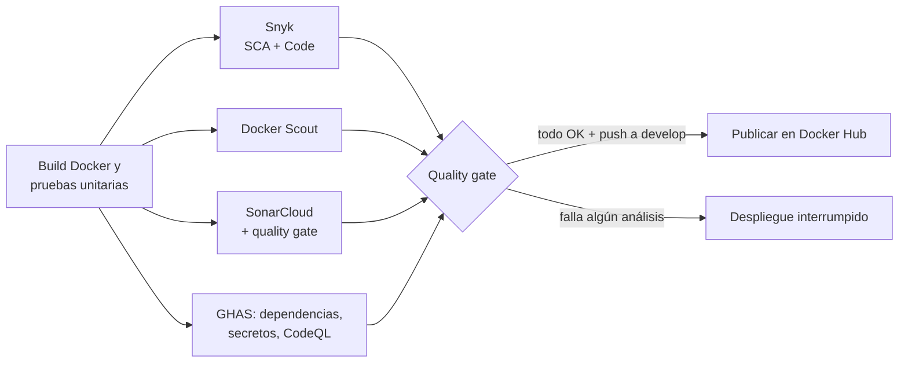
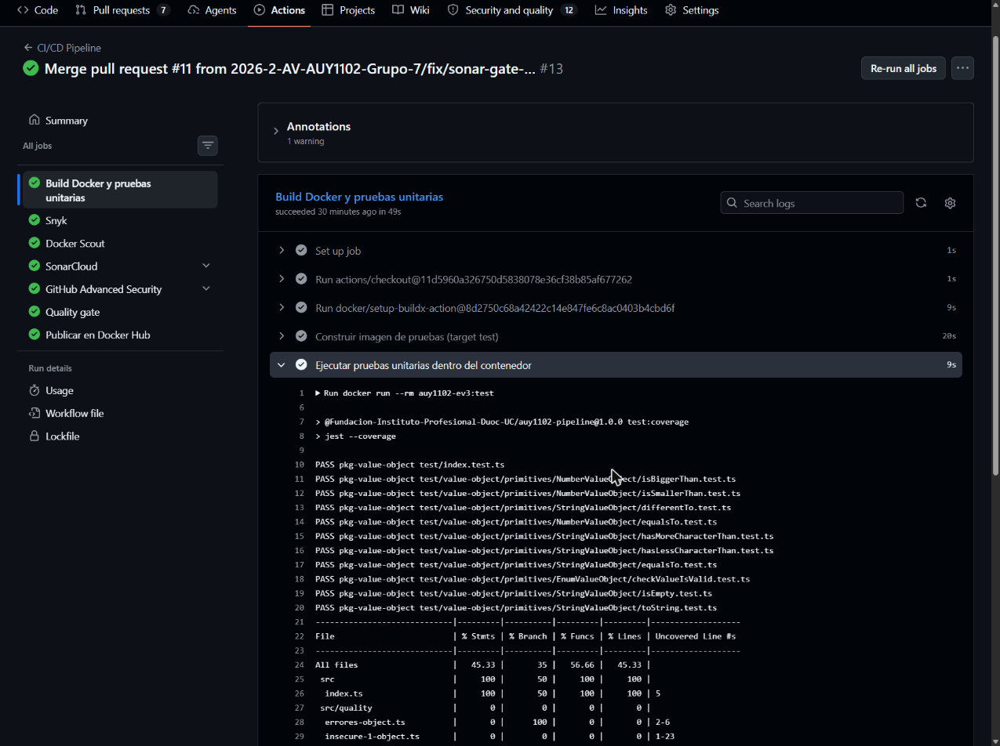
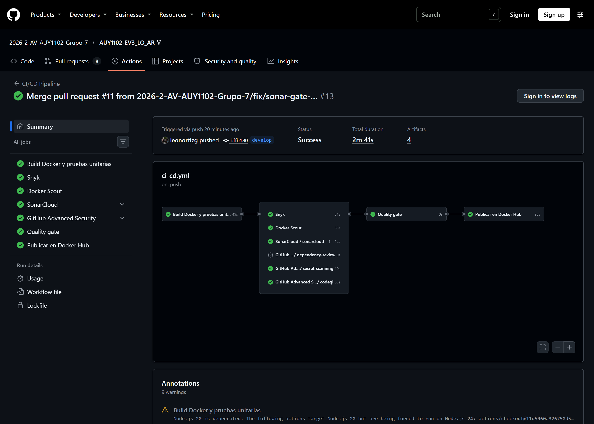
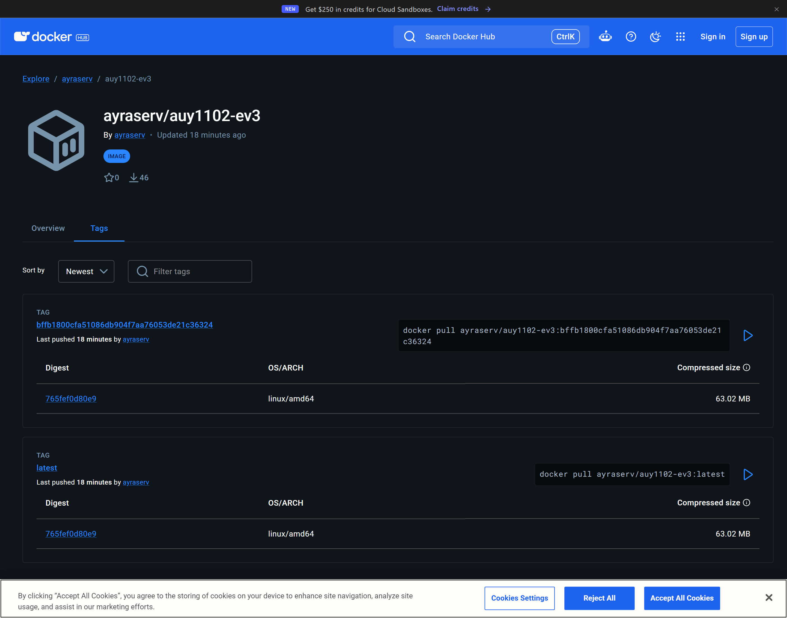
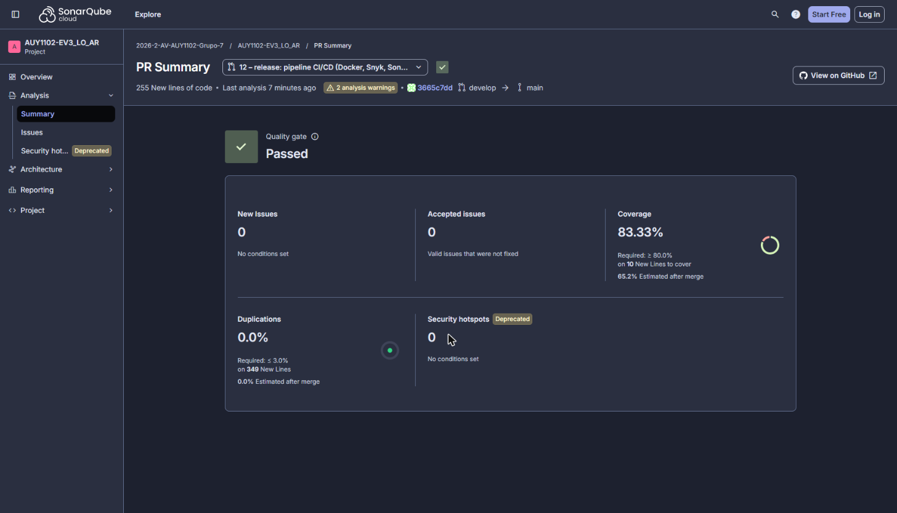
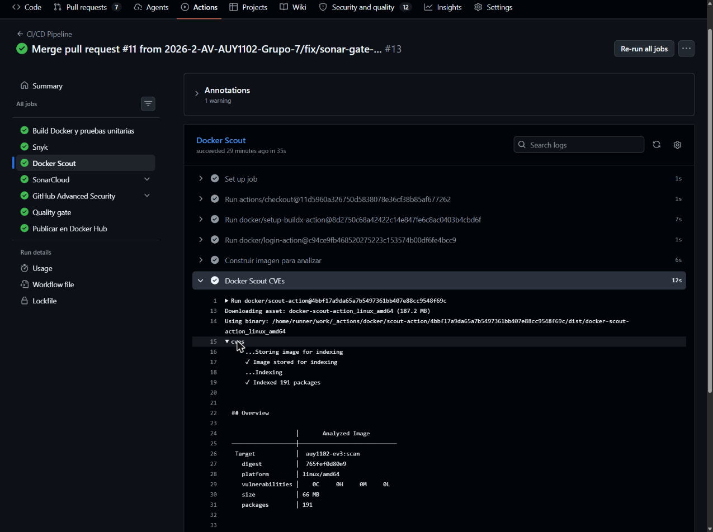
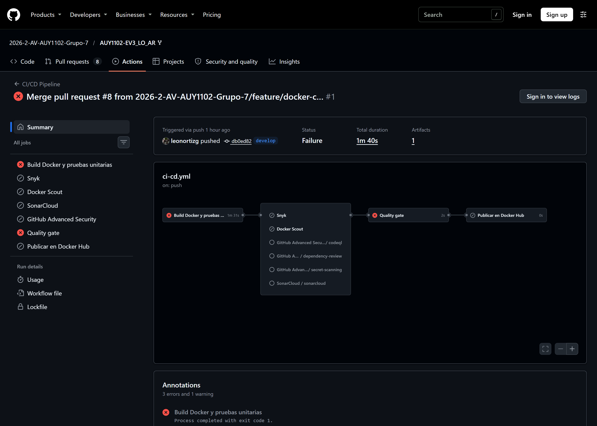
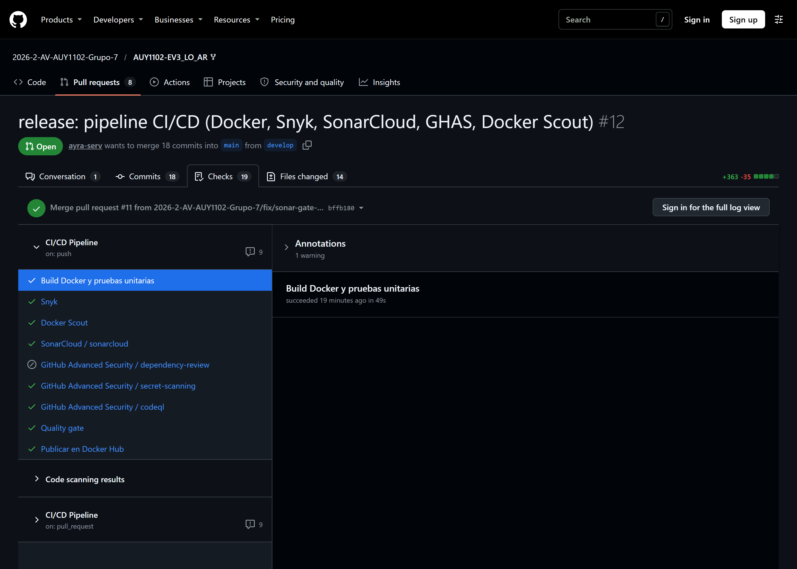

# Informe técnico: Pipeline CI/CD con GitHub Actions y Docker

**Evaluación Parcial N° 3 · AUY1102 Ciclo de Vida del Software I · Aseguramiento de la Calidad del Software con GitHub y GitHub Actions**

| Dato | Valor |
|---|---|
| Repositorio | [2026-2-AV-AUY1102-Grupo-7/AUY1102-EV3_LO_AR](https://github.com/2026-2-AV-AUY1102-Grupo-7/AUY1102-EV3_LO_AR) (público) |
| Repositorio de origen (fork) | [AUY1102-EV2_LO_AR](https://github.com/2026-2-AV-AUY1102-Grupo-7/AUY1102-EV2_LO_AR) |
| Integrantes | **Albert Ruiz**: Parte 1 (Dockerfile, build, pruebas en contenedor, Docker Hub) y análisis con **Snyk** y **Docker Scout** · **Leonardo Ortiz**: **SonarCloud**, **GitHub Advanced Security** y revisión/aprobación de los Pull Requests |
| Fecha | 27-11-2026 |
| Ramas | `main` (entrega), `develop` (integración), ramas `feature/*` y `fix/*` por tarea |
| Imagen publicada | [`ayraserv/auy1102-ev3`](https://hub.docker.com/r/ayraserv/auy1102-ev3/tags) en Docker Hub |

---

## Índice

1. [Contexto y objetivo](#1-contexto-y-objetivo)
2. [IE4.1.1 · Componentes de CI/CD](#2-ie411--componentes-de-cicd)
3. [IE4.2.1 · Diseño del pipeline](#3-ie421--diseño-del-pipeline)
4. [IE4.3.1 · Implementación del pipeline](#4-ie431--implementación-del-pipeline)
   - [4.1 Parte 1: Docker y GitHub Actions](#41-parte-1-docker-y-github-actions)
   - [4.2 Parte 2: Análisis de código y seguridad](#42-parte-2-análisis-de-código-y-seguridad)
   - [4.3 Compuerta de calidad](#43-compuerta-de-calidad-y-corte-del-despliegue)
5. [Trabajo colaborativo](#5-trabajo-colaborativo)
6. [Problemas encontrados y cómo se resolvieron](#6-problemas-encontrados-y-cómo-se-resolvieron)
7. [Resultados consolidados](#7-resultados-consolidados)
8. [Consideraciones éticas, riesgos residuales y recomendaciones](#8-consideraciones-éticas-riesgos-residuales-y-recomendaciones)
9. [Conclusiones](#9-conclusiones)
10. [Anexos](#10-anexos)

---

## 1. Contexto y objetivo

La evaluación pide construir, sobre un fork del repositorio indicado, un **pipeline de Integración Continua y Despliegue Continuo** que:

- **Parte 1:** dockerice la aplicación, ejecute las pruebas unitarias **dentro del contenedor** y publique la imagen en **Docker Hub** solo si las pruebas pasan. Se dispara en cada *push* a `develop` y en cada *pull request* a `main`.
- **Parte 2:** integre **SonarCloud**, **Snyk**, **GitHub Advanced Security** (análisis de dependencias y escaneo de secretos) y **Docker Scout**, y **interrumpa el despliegue** si se detectan problemas críticos de seguridad o calidad.

El código base es una librería TypeScript de *value objects* con pruebas Jest, la misma de la EV2.

## 2. IE4.1.1 · Componentes de CI/CD

| Componente | Qué es | Cómo se usa en este trabajo |
|---|---|---|
| **Integración Continua (CI)** | Cada cambio se compila y prueba automáticamente al integrarse. | Job `Build Docker y pruebas unitarias`: construye la imagen y corre Jest dentro del contenedor. |
| **Entrega/Despliegue Continuo (CD)** | La versión validada se publica sin pasos manuales. | Job `Publicar en Docker Hub`, que solo corre tras pasar la compuerta. |
| **Pipeline como código** | El flujo vive versionado en el repositorio. | `.github/workflows/ci-cd.yml` más los workflows reutilizables `sonarcloud.yml` y `ghas.yml`. |
| **Contenedor / Docker** | Empaqueta la app con su entorno para que sea reproducible. | `Dockerfile` multi-etapa (`base`, `test`, `build`, `runtime`). |
| **Registro de imágenes** | Almacena las imágenes versionadas. | Docker Hub (`latest` y etiqueta con el SHA del commit). |
| **Análisis estático (SAST)** | Revisa el código sin ejecutarlo. | SonarCloud, Snyk Code y CodeQL. |
| **Análisis de dependencias (SCA)** | Busca CVE en librerías. | Snyk Open Source, *dependency-review* y Dependabot. |
| **Análisis de imágenes** | Busca CVE en la imagen final. | Docker Scout. |
| **Escaneo de secretos** | Detecta credenciales en el código. | TruffleHog en el pipeline y *Secret scanning* con *Push protection* de GitHub. |
| **Quality gate** | Criterio automático de aprobación. | Job `Quality gate` más el gate propio de SonarCloud. |
| **Secretos del pipeline** | Credenciales fuera del código. | *GitHub Actions secrets*: `DOCKERHUB_USERNAME`, `DOCKERHUB_TOKEN`, `SNYK_TOKEN`, `SONAR_TOKEN`. |

**Integridad del código y consideraciones éticas:** ninguna credencial se escribe en el repositorio (se inyectan como *secrets*), las acciones de terceros se fijan por SHA de commit para evitar ataques a la cadena de suministro, los PRs pasan por revisión cruzada y los problemas detectados se corrigen en vez de ocultarse o silenciarse (sección 8).

## 3. IE4.2.1 · Diseño del pipeline

### 3.1 Disparadores

```yaml
on:
  push:
    branches: [develop]
  pull_request:
    branches: [main]
```

- **Push a `develop`:** valida la integración y, si todo pasa, **publica** la imagen.
- **Pull request a `main`:** ejecuta los mismos análisis **sin publicar**, para revisar antes de entregar.

### 3.2 Flujo de trabajo y de ramas

```
feature/* ──PR + revisión cruzada──▶ develop ──push──▶ pipeline completo + publicación Docker Hub
                                        │
                                        └──PR──▶ main ──▶ pipeline completo (sin publicar)
```

### 3.3 Diagrama de jobs



### 3.4 Decisiones de diseño

| Decisión | Justificación |
|---|---|
| **Dockerfile multi-etapa** con una etapa `test` | Permite ejecutar las pruebas **dentro del contenedor** con las mismas dependencias que la imagen y publicar una imagen final mínima y sin herramientas de desarrollo. |
| Análisis **en paralelo** tras el build | Reduce el tiempo total (~2 min 40 s) y aísla las fallas de cada herramienta. |
| **Workflows reutilizables** (`workflow_call`) para SonarCloud y GHAS | Separan el trabajo de cada integrante y evitan duplicar lógica. |
| Job `Quality gate` con `if: always()` | Se ejecuta aun si un análisis falló y bloquea el despliegue de forma explícita. `publish` depende de este job. |
| Publicar solo en `push` a `develop` | Los PRs no publican imágenes sin aprobar. |
| Etiquetas `latest` y `<sha-del-commit>` | Trazabilidad: cada imagen se asocia a un commit. |
| Acciones fijadas por **SHA** | Evita que una etiqueta mutable ejecute código no revisado (regla `S7637` de SonarCloud). |
| **Permisos mínimos por job** | Reduce el impacto de un compromiso del *token* del workflow. |
| Umbral **critical** en Snyk y Docker Scout | Interrumpe el despliegue ante lo más grave sin bloquear por ruido. |

## 4. IE4.3.1 · Implementación del pipeline

Archivos principales:

| Archivo | Contenido |
|---|---|
| [`Dockerfile`](Dockerfile) | Imagen multi-etapa sobre `node:24.22.2-alpine3.24`. |
| [`.dockerignore`](.dockerignore) | Excluye `.git`, `node_modules`, `.npmrc`, `credentials.yml`, etc. |
| [`.github/workflows/ci-cd.yml`](.github/workflows/ci-cd.yml) | Orquestación: build, tests, Snyk, Scout, gate y publicación. |
| [`.github/workflows/sonarcloud.yml`](.github/workflows/sonarcloud.yml) | SonarCloud con cobertura y quality gate. |
| [`.github/workflows/ghas.yml`](.github/workflows/ghas.yml) | Dependency review, TruffleHog y CodeQL. |
| [`sonar-project.properties`](sonar-project.properties) | Organización `2026-2-av-auy1102-grupo-7`, proyecto `2026-2-AV-AUY1102-Grupo-7_AUY1102-EV3_LO_AR`. |

### 4.1 Parte 1: Docker y GitHub Actions

**Fork y repositorio.** Se hizo fork de `AUY1102-EV2_LO_AR` con el nombre `AUY1102-EV3_LO_AR` y se transfirió a la organización del grupo. Es **público**. Se crearon las ramas `main` y `develop`.

**Dockerfile** (etapas):

```dockerfile
FROM node:24.22.2-alpine3.24 AS base      # dependencias (npm ci)
FROM base AS test                         # CMD npm run test:coverage
FROM base AS build                        # npm run build (tsc)
FROM node:24.22.2-alpine3.24 AS runtime   # apk upgrade, npm ci --omit=dev, USER node
```

**Pasos automatizados** (job `build-and-test`):

1. Construcción de la imagen de pruebas (`target: test`) con caché de GitHub Actions.
2. **Ejecución de las pruebas unitarias dentro del contenedor:** `docker run --rm auy1102-ev3:test`.
3. Construcción de la imagen final (`target: runtime`).
4. Publicación en Docker Hub (job `publish`), solo si pasó la compuerta y el evento es *push* a `develop`.


_Figura 1. `docker run` de la imagen `test`: 10 suites en PASS con cobertura, ejecutadas dentro del contenedor._


_Figura 2. Ejecución del pipeline en `develop` tras el merge del PR #11: 8 jobs pasan y 1 se omite (`dependency-review`, que solo aplica a PRs) y `Publicar en Docker Hub` termina en 26 s._


_Figura 3. Imagen `ayraserv/auy1102-ev3` publicada en Docker Hub con las etiquetas `latest` y el SHA del commit `bffb180…`._

### 4.2 Parte 2: Análisis de código y seguridad

#### SonarCloud (Leonardo)

- Proyecto importado en la organización del grupo y con el *Automatic Analysis* **desactivado** para que el análisis lo haga el pipeline.
- Job `sonarcloud.yml`: ejecuta Jest con cobertura `lcov`, lanza el análisis (`sonarqube-scan-action`) y verifica el *quality gate* (`sonarqube-quality-gate-action`).


_Figura 4. PR #12 (`develop` → `main`): **Quality gate Passed**, 0 issues nuevos, cobertura 83,33 % en código nuevo (exigido ≥ 80 %), 0,0 % de duplicación._

#### Snyk (Albert)

- Job `snyk`: instala dependencias y ejecuta `snyk test --severity-threshold=critical` (*Open Source*, SCA) y `snyk code test --severity-threshold=critical` (*Code*, análisis estático). Usa el secreto `SNYK_TOKEN`.
- Se habilitó **Snyk Code** en la organización de Snyk (en la EV2 estaba deshabilitado y daba el error `SNYK-CODE-0005`).
- Resultado en `develop`: job **Snyk en verde** (Figura 2). Los hallazgos que Snyk Code encontró en las ejecuciones previas se corrigieron (sección 6).

#### GitHub Advanced Security (Leonardo)

Workflow `ghas.yml`, invocado desde el pipeline:

| Job | Función | Resultado |
|---|---|---|
| `dependency-review` | **Análisis de dependencias** en PRs: bloquea dependencias con vulnerabilidades críticas. | OK en el PR #12 |
| `secret-scanning` | **Escaneo de secretos** con TruffleHog (verificados y desconocidos). | OK |
| `codeql` | Análisis estático de JavaScript/TypeScript, con resultados en la pestaña *Security*. | OK |

Además, en el repositorio se activaron *Dependabot alerts*, *Dependabot security updates*, **Secret scanning** y **Push protection**. Estado al 27-11-2026:

| Función de GHAS | Estado |
|---|---|
| Alertas de *code scanning* (CodeQL) | **0** abiertas |
| Alertas de *secret scanning* | **0** abiertas |
| Alertas de Dependabot | 28 abiertas (10 *high*, 14 *medium*, 4 *low*); **27 son de dependencias de desarrollo** y 1 de runtime |

#### Docker Scout (Albert)

- Job `docker-scout`: construye la imagen final y ejecuta `docker/scout-action` con `command: cves`, `only-severities: critical` y `exit-code: true` (falla si hay CVE críticos). Se autentica con Docker Hub.


_Figura 5. Docker Scout sobre `auy1102-ev3:scan`: **0C · 0H · 0M · 0L** en 191 paquetes (imagen de 66 MB)._

### 4.3 Compuerta de calidad y corte del despliegue

El job `Quality gate` depende de Snyk, Docker Scout, SonarCloud y GHAS, y falla si **cualquiera** no terminó en `success`:

```yaml
quality-gate:
  needs: [snyk, docker-scout, sonarcloud, ghas]
  if: always()
  # falla (exit 1) si alguno de los 4 resultados != success
publish:
  needs: [build-and-test, quality-gate]   # no corre si el gate falla
```

La compuerta se comprobó **en la práctica**. En la primera ejecución en `develop` las pruebas fallaron dentro del contenedor, los análisis posteriores no se ejecutaron, el `Quality gate` falló y **`Publicar en Docker Hub` no corrió**:


_Figura 6. Primera ejecución (PR #8 mergeado): `Build Docker y pruebas unitarias` falla → `Quality gate` falla → `Publicar en Docker Hub` queda omitido (despliegue interrumpido)._

Las ejecuciones en PRs a `main` también se validan:


_Figura 7. PR #12 (`develop` → `main`): los 19 checks del pipeline en PR y en push, todos en verde._

## 5. Trabajo colaborativo

Cada integrante tuvo responsabilidades distintas. Todo cambio entró por **Pull Request revisado y fusionado por Leonardo**, con aprobación registrada.

| Responsable | Actividad |
|---|---|
| **Albert Ruiz** | Fork y repositorio; Dockerfile multi-etapa y `.dockerignore`; `ci-cd.yml` (build, pruebas en contenedor, Snyk, Docker Scout, quality gate y publicación en Docker Hub); creación del token de Docker Hub; habilitación de Snyk Code; corrección de los hallazgos (sección 6). |
| **Leonardo Ortiz** | Integración de **SonarCloud** (proyecto, token, quality gate) y **GitHub Advanced Security** (workflows reutilizables `sonarcloud.yml` y `ghas.yml`); **revisión, aprobación y merge** de los PRs #7, #8, #10 y #11. |

**Nota:** las ramas `feature/sonar-ghas-leonardo` y `fix/*` se subieron desde la cuenta `ayra-serv`. La **revisión y aprobación de cada PR la hizo Leonardo desde su propia cuenta**.

| Pull Request | Contenido | Revisión |
|---|---|---|
| [#7](https://github.com/2026-2-AV-AUY1102-Grupo-7/AUY1102-EV3_LO_AR/pull/7) | Workflows de SonarCloud y GHAS | Aprobado y fusionado por `leonortizg` |
| [#8](https://github.com/2026-2-AV-AUY1102-Grupo-7/AUY1102-EV3_LO_AR/pull/8) | Dockerfile y pipeline (Docker, Snyk, Scout) | Aprobado y fusionado por `leonortizg` |
| [#9](https://github.com/2026-2-AV-AUY1102-Grupo-7/AUY1102-EV3_LO_AR/pull/9) | Borrador de validación en un PR a `main` | Cerrado |
| [#10](https://github.com/2026-2-AV-AUY1102-Grupo-7/AUY1102-EV3_LO_AR/pull/10) | Correcciones de pruebas, build, seguridad y gate | Aprobado y fusionado por `leonortizg` |
| [#11](https://github.com/2026-2-AV-AUY1102-Grupo-7/AUY1102-EV3_LO_AR/pull/11) | Quality gate de SonarCloud solo en PRs | Aprobado y fusionado por `leonortizg` |
| [#12](https://github.com/2026-2-AV-AUY1102-Grupo-7/AUY1102-EV3_LO_AR/pull/12) | Entrega `develop` → `main` | Pipeline en verde |

Evidencias de las revisiones en `docs/evidencias/ev3/leonardo/` (`02` a `07`).

## 6. Problemas encontrados y cómo se resolvieron

El pipeline se iteró hasta quedar en verde. Cada falla fue una detección real de la herramienta correspondiente.

| # | Problema detectado | Herramienta | Causa | Solución |
|---|---|---|---|---|
| 1 | 9 de 10 suites fallaban en el contenedor | Jest en Docker | `@faker-js/faker` v10 es solo ESM y su API cambió | `transformIgnorePatterns` en `jest.config.js`; `number.int()` y manejo de longitud 0 en `test/mother-object/`. **18/18 pruebas** pasan. |
| 2 | Falló la construcción de la imagen | `tsc` | Los archivos de demostración `src/quality/*` no compilan a propósito | Se excluyen de `tsconfig.json`. |
| 3 | Acciones sin fijar por SHA (severidad alta) y permisos amplios | SonarCloud `S7637`, `S8233`, `S8264` | Se usaban etiquetas como `@v4` o `@main` | Todas las acciones de terceros fijadas por SHA; permisos mínimos por job. |
| 4 | `trufflehog: flag 'fail' cannot be repeated` | TruffleHog | La acción ya agrega `--fail` | Se quitó el `--fail` duplicado. |
| 5 | Falló la escritura del comentario en el PR | Docker Scout | Faltaba el permiso `pull-requests: write` | Permisos del job ajustados. |
| 6 | **CVE crítico `CVE-2026-4738`** en `zlib` | Docker Scout | Paquete del sistema base Alpine | `RUN apk upgrade --no-cache` en la imagen final → **0 vulnerabilidades**. |
| 7 | `Snyk Code is not enabled (SNYK-CODE-0005)` | Snyk | La función estaba apagada en la organización | Se habilitó *Snyk Code* en *Settings*. |
| 8 | Secreto escrito en `src/index.ts` (High) y XSS en `src/quality/insecure-1-object.ts` (High) | Snyk Code | Credenciales en el código y entrada sin sanear | Credenciales por variable de entorno; entrada filtrada con lista blanca; el endpoint responde JSON y se oculta `X-Powered-By`. |
| 9 | Contraseñas escritas en `src/quality/insecure-2-object.ts` (Medium) | Snyk Code | Credenciales en el código | Se leen de variables de entorno. |
| 10 | *Log injection* (`tssecurity:S5145`) y cobertura nueva < 80 % | SonarCloud | `console.log` de datos de red; `index.ts` sin pruebas | `fetchData` devuelve el dato sin registrarlo; se agregó `test/index.test.ts` (3 pruebas). |
| 11 | HTTP 403 al consultar el quality gate en `develop` | SonarCloud | El plan gratuito solo permite consultar el gate de PRs y de `main` | El paso del gate se ejecuta solo en PRs (`if: github.event_name == 'pull_request'`); el análisis sigue corriendo en todos los eventos. |

## 7. Resultados consolidados

| Requisito de la evaluación | Estado | Evidencia |
|---|---|---|
| Fork del repositorio indicado, público | Cumplido | Repositorio de la organización |
| Dockerfile para dockerizar la aplicación | Cumplido | `Dockerfile` |
| Construcción de la imagen en Actions | Cumplido | Fig. 2 |
| Pruebas unitarias dentro del contenedor | Cumplido (18/18 pruebas) | Fig. 1 |
| Publicación en Docker Hub si las pruebas pasan | Cumplido | Fig. 3 |
| Disparo en push a `develop` y PR a `main` | Cumplido | Fig. 2 y Fig. 7 |
| SonarCloud en PRs a `main` | Cumplido, quality gate Passed | Fig. 4 |
| Snyk (análisis estático de código y dependencias) | Cumplido | Fig. 2 |
| GHAS: análisis de dependencias y escaneo de secretos | Cumplido | Sección 4.2 |
| Docker Scout | Cumplido, 0 vulnerabilidades | Fig. 5 |
| Interrupción del despliegue ante problemas críticos | Cumplido y comprobado | Fig. 6 |

| Métrica | Valor |
|---|---|
| Duración del pipeline completo | ≈ 2 min 41 s |
| Pruebas unitarias | 18/18 (10 suites) |
| SonarCloud (PR #12) | Gate **Passed** · 0 issues nuevos · cobertura nueva 83,33 % |
| Docker Scout | **0** vulnerabilidades (antes: 1 crítica) |
| Alertas abiertas de code scanning / secret scanning | 0 / 0 |

## 8. Consideraciones éticas, riesgos residuales y recomendaciones

| Tema | Detalle y recomendación |
|---|---|
| **Secretos** | Los tokens se cargaron directamente en *GitHub Actions secrets* y no se escribieron en el código. Algunos tokens quedaron visibles durante la sesión de trabajo: **revocarlos y generar nuevos** antes de cerrar el trabajo (Docker Hub, Snyk, SonarCloud). |
| **`.npmrc` con token** | El repositorio heredado contiene un token de GitHub Packages en texto plano. Se excluyó de la imagen con `.dockerignore`, pero sigue en el repositorio y en el historial: **revocarlo** y usar una variable de entorno. |
| **Código de demostración** | `src/quality/*` contiene código inseguro intencional de la actividad de la EV2. Se excluyó de la compilación y de la cobertura. Quedan hallazgos *Medium* en `insecure-2-object.ts` que no bloquean el pipeline. |
| **Dependabot** | 28 alertas abiertas, casi todas de dependencias de **desarrollo** (no se despliegan en la imagen). Recomendación: actualizar el *tooling* en un ciclo aparte con pruebas de regresión. |
| **Quality gate de SonarCloud en `develop`** | Por el límite del plan gratuito solo se verifica en PRs; la protección de `main` depende de ese gate. Un plan de pago permitiría verificar también `develop`. |
| **Revisión de PRs** | En el PR #7 la aprobación se registró **después** del merge; en los PRs #8, #10 y #11 se aprobó antes de fusionar. Se recomienda activar **protección de ramas** (aprobación obligatoria y *checks* requeridos) en `main` y `develop`. |
| **Pruebas locales** | El entorno de desarrollo no tenía Node ni motor de Docker en ejecución, por lo que **todas las validaciones se hicieron en GitHub Actions**. |

## 9. Conclusiones

- Se construyó un pipeline que **dockeriza** la aplicación, ejecuta las **pruebas dentro del contenedor** y **publica en Docker Hub** solo si todo pasa, con disparo en push a `develop` y en PR a `main`.
- Se integraron **SonarCloud, Snyk, GitHub Advanced Security y Docker Scout**, y una **compuerta de calidad** que interrumpe el despliegue. Esta se comprobó en una ejecución real que falló y bloqueó la publicación.
- Las herramientas fueron **complementarias**: Docker Scout encontró un CVE crítico de la imagen, Snyk Code detectó secretos y un XSS, y SonarCloud señaló riesgos en los propios workflows y exigió cobertura. Ninguna de las tres lo habría detectado todo por sí sola.
- Iterar el pipeline y corregir cada hallazgo, en vez de debilitar los umbrales, dejó el resultado final en **0 vulnerabilidades en la imagen**, quality gate **Passed** y **0 alertas** de code scanning y secret scanning.
- El flujo con **ramas, PRs y revisión cruzada** dejó trazabilidad de cada cambio y repartió las responsabilidades entre los dos integrantes.

## 10. Anexos

### 10.1 Commits principales (`develop`)

| Commit | Descripción |
|---|---|
| `7a666cc` | feat(ci): workflows reutilizables de SonarCloud y GHAS |
| `8bc2a51` | fix(sonar): claves reales de organización y proyecto |
| `349a217` | feat(ci): Dockerfile multi-etapa y pipeline CI/CD con Docker, Snyk y Docker Scout |
| `d86446a`, `589b48a`, `d91babc` | fix(test): faker v10 (ESM, `number.int()`, longitud 0) |
| `1a92adc` | fix(build): excluir `src/quality` de la compilación |
| `ee9f304`, `2b08cca` | fix(ci): acciones por SHA, permisos mínimos, TruffleHog, `packages: read` |
| `cf57f4f` | fix(docker): `apk upgrade` para parchear CVE crítico de zlib |
| `2ae018a`, `71b0991`, `9a23341` | fix(security): secretos fuera del código, XSS, log injection, pruebas de `fetchData` |
| `d77d2de` | fix(ci): quality gate de SonarCloud solo en PRs |

### 10.2 Evidencias en el repositorio

```
docs/evidencias/ev3/albert/     capturas del pipeline, pruebas en contenedor, Docker Scout, Docker Hub y checks del PR #12
docs/evidencias/ev3/leonardo/   SonarCloud (quality gate) y revisiones/aprobaciones de los PRs #7, #8, #10 y #11
```

### 10.3 Ejecuciones de Actions

| Ejecución | Evento | Resultado |
|---|---|---|
| [45933335910](https://github.com/2026-2-AV-AUY1102-Grupo-7/AUY1102-EV3_LO_AR/actions/runs/45933335910) | push a `develop` (PR #8) | Falla en pruebas; la compuerta bloquea la publicación |
| [45937376352](https://github.com/2026-2-AV-AUY1102-Grupo-7/AUY1102-EV3_LO_AR/actions/runs/45937376352) | push a `develop` (PR #11) | **Éxito** y publicación en Docker Hub |
| [45937681163](https://github.com/2026-2-AV-AUY1102-Grupo-7/AUY1102-EV3_LO_AR/actions/runs/45937681163) | PR #12 a `main` | **Éxito** (sin publicar) |

### 10.4 Cómo reproducir

```bash
git clone https://github.com/2026-2-AV-AUY1102-Grupo-7/AUY1102-EV3_LO_AR.git
cd AUY1102-EV3_LO_AR
docker build --target test -t auy1102-ev3:test .
docker run --rm auy1102-ev3:test            # pruebas unitarias dentro del contenedor
docker build --target runtime -t auy1102-ev3:local .
```

Secretos requeridos en *Settings → Secrets and variables → Actions*: `DOCKERHUB_USERNAME`, `DOCKERHUB_TOKEN`, `SNYK_TOKEN`, `SONAR_TOKEN`.
